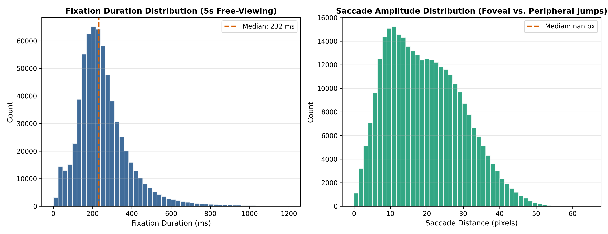
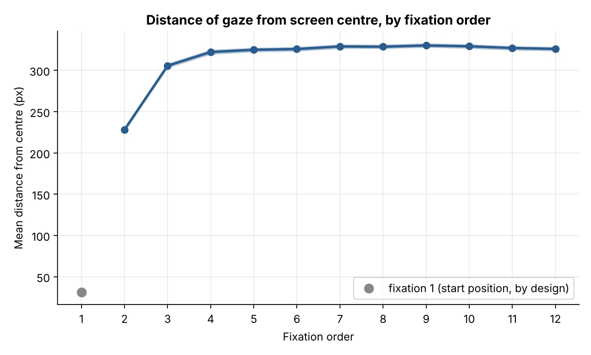
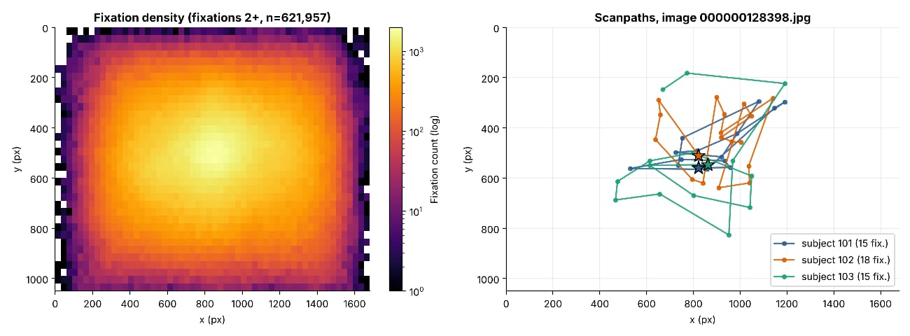
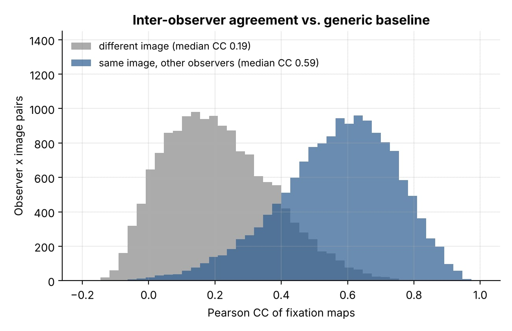
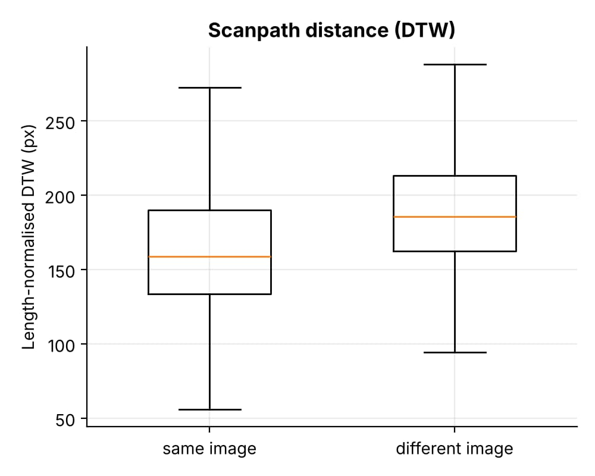

# Human Gaze Dynamics in Natural Scenes (COCO-FreeView)

Descriptive + comparative analysis of free-viewing eye-tracking data: **43,048 trials, 665,005 fixations, 10 observers, 4,317 images** (COCO-FreeView train+valid splits; Chen et al., 2022, *Characterizing Target-Absent Human Attention*, CVPRW).

**Question:** how does gaze unfold over a 5 s free-viewing trial, and how much of it is shared between observers rather than just a generic centre bias?

## Key results
| Measure | Result |
|---|---|
| Fixation duration (fixations 2+) | median **230 ms** (IQR 168-315), right-skewed |
| Saccade amplitude | median **213 px** (IQR 93-374) |
| Start position | Fixation 1 sits at the screen centre (mean 838, 520; SD ~35 px) - the dataset readme states the first fixation is the initial centre fixation, so it is excluded from centre-bias claims |
| Spread over time | mean distance from centre rises from ~228 px (fixation 2) to a plateau of ~325 px by fixation 4-5 (95% CI via bootstrap over images) |
| Inter-observer agreement | fixation-map correlation **0.59** on the same image vs **0.19** across different images (same > different in 94% of pairs) |
| Scanpath agreement | DTW distance 159 px (same image) vs 186 px (different image) |
| Individual differences | median saccade amplitude ranges from ~109 px (subject 102) to ~289 px (subject 104) |

## Figures
All produced by `coco_freeview_gaze_analysis.ipynb`.

**1. Fixation duration and saccade amplitude**


**2. Gaze distance from centre by fixation order** (fixation 1 is the forced start position)


**3. Fixation density and multi-observer scanpaths**


**4. Individual differences between observers**


**5. Inter-observer agreement vs. generic baseline**


**6. Scanpath distance (DTW)**


## Reproduce
```
pip install numpy pandas scipy matplotlib jupyter
# put COCOFreeView_fixations_trainval.json next to the notebook
jupyter notebook coco_freeview_gaze_analysis.ipynb
```
Random seed fixed (`default_rng(0)`).

## Limitations
Pixels on a 1680x1050 zero-padded canvas, not degrees of visual angle (as no viewing distance was given in the source); train+valid splits only (665k out of 822k fixations); only 10 observers; map correlation and DTW are coarse measures (MultiMatch / ScanMatch / NSS / AUC are natural next steps).
