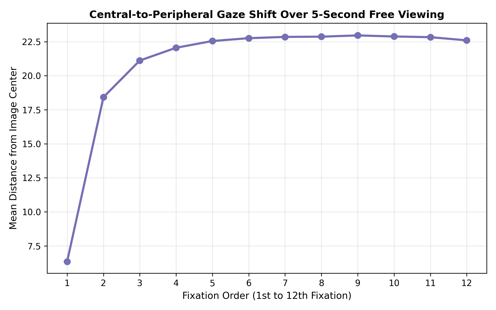
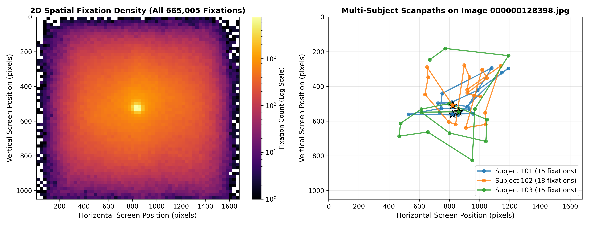

# Visual_attention_scanpaths
# Exploratory Analysis of Human Gaze Trajectories in Natural Scenes (COCO-FreeView)

## Overview
This project analyzes human free-viewing eye-tracking dynamics across **43,048 trials** and **665,005 fixations** from the **COCO-FreeView** dataset (5-second viewing window on natural photographs, `1680 × 1050` resolution). Built in Python (`NumPy`, `Matplotlib`), the pipeline examines temporal attention, saccade kinematics, and central-to-peripheral visual exploration.

## Key Findings & Visualizations

### 1. Fixation Duration & Saccade Amplitude Distributions
* **Temporal Attention:** Human fixations follow a right-skewed distribution with a **median duration of 232.0 ms**, separating brief bottom-up orienting fixations from longer semantic inspection fixations.
* **Spatial Kinematics:** Saccade jump amplitudes capture the balance between local high-acuity foveal adjustments and longer exploratory shifts across the visual field.

### 2. Central-to-Peripheral Gaze Shift Over Time
* Tracking mean Euclidean distance from the screen center `(840, 525 px)` across fixation order reveals a strong **initial central fixation bias** on Fixation 1, followed by rapid outward expansion into peripheral visual space over Fixations 2–5.

### 3. Spatial Fixation Density & Inter-Subject Scanpaths
* Comparing 2D log-density maps across all 665,005 fixations alongside individual participant trajectories demonstrates both shared central/horizontal saliency hotspots and individual scanpath variability on identical stimuli.

## Repository Contents
* `coco_freeview_gaze_analysis.ipynb` — Complete Python analysis notebook.
* `figure1_fixation_saccade_stats.png` — Fixation duration and saccade amplitude histograms.
* `figure2_center_bias_trajectory.png` — Temporal progression from central to peripheral gaze.
* `figure3_scanpaths_and_heatmap.png` — 2D log-density fixation map and multi-subject scanpath overlay.

## Tools Used
* **Language:** Python 3
* **Libraries:** `json`, `numpy`, `matplotlib`
